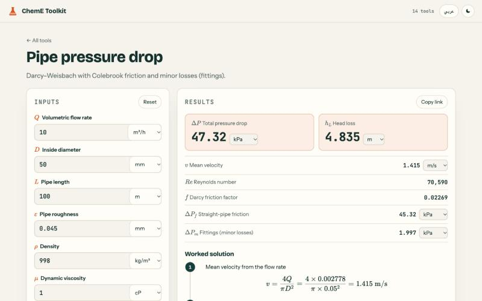
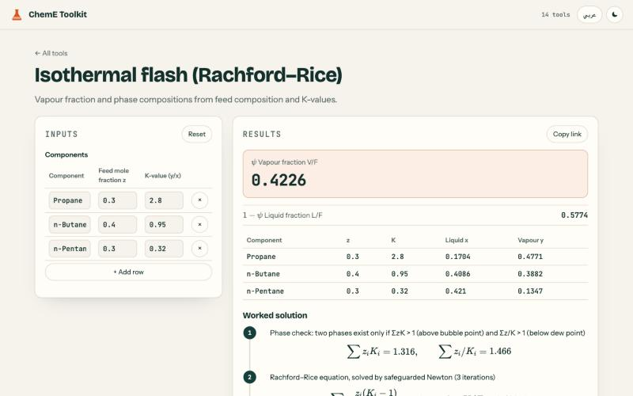

# ChemE Toolkit

**Chemical engineering calculations with units, and the worked solution behind every answer.**
English and Arabic · works offline on phones · free and open source.

**▶ Live app:** https://cheme-toolkit.vercel.app/



## Why

Students reach for a calculator and get a number. This toolkit shows **how** the number was obtained: each tool lists the equation, substitutes your values (converted to SI) and walks to the answer, so it can be checked, cited in a report, or used to learn the method.

## Tools

| Fluid flow | Heat transfer | Thermodynamics | Separations & reactions |
|---|---|---|---|
| Reynolds number | LMTD and exchanger area | Saturated steam table (IAPWS-IF97) | Isothermal flash (Rachford–Rice) |
| Darcy friction factor (Colebrook) | Heat exchanger ε-NTU | Vapour pressure (Antoine, 15 compounds) | Arrhenius rate constant / activation energy |
| Pipe pressure drop with fittings | Tube-side h (Gnielinski, Dittus–Boelter) | Ideal gas law and density | |
| Pump power and head | Composite wall conduction | Psychrometrics (moist air) | |

Plus a **unit calculator** for any expression: `2.5 bar * 30 L/min to kW`, `998 kg/m^3 * 1.5 m/s * 50 mm / (1 cP)`, `gasConstant * 298 K / (101.325 kPa) to L/mol`.

### Features

- **Every input in the units you use**: bar, psi, kPa, °C, °F, K, cP, Pa·s, L/min, US gpm, m³/h, BTU/h… Changing a unit converts the number, so the physical value stays the same.
- **Worked solution** for every result, typeset with KaTeX, plus warnings when a correlation is used outside its range (transitional flow, extrapolated Antoine constants…).
- **Share a calculation**: the address bar always holds your inputs, so "Copy link" reproduces the exact case.
- **English / العربية** with a right-to-left layout (equations stay left-to-right), light and dark themes.
- **Offline**: once opened, it keeps working without a connection and can be installed on a phone's home screen.



## Accuracy

Every model is tested against published reference values (`npm test`, 115 tests):

- **IAPWS-IF97** regions 1, 2 and 4 reproduce the official verification tables to 8 significant figures.
- **Antoine** constants (Felder & Rousseau, Table B.4) are checked by recomputing each compound's normal boiling point.
- Friction factor against the Moody chart; ε-NTU, LMTD and psychrometrics against textbook values; energy balances and round trips (k → Eₐ → k) for consistency.

Results are for teaching and preliminary design: always check them against engineering judgement and the relevant design codes.

## Run it locally

```bash
npm install
npm run dev      # http://localhost:5173
npm test         # 115 tests
npm run build    # production build in dist/
```

Pushing to `main` rebuilds and publishes the live app on Vercel.

### Adding a tool

Each tool is one object in `src/tools/` with its inputs (dimension and default unit), optional choices or a table, and a `compute()` that receives SI values and returns results plus LaTeX steps. Add it to `src/tools/index.ts` and it appears on the home page, with unit pickers, sharing and both languages handled for you.

## Built with

React 19 · TypeScript · Vite · KaTeX · mathjs (unit calculator) · Vitest

## Author

Dr. Aboulbaba Eladeb, Chemical Engineering, Northern Border University · [eladebaboulbaba.com](https://eladebaboulbaba.com)

## Licence

[MIT](LICENSE)
